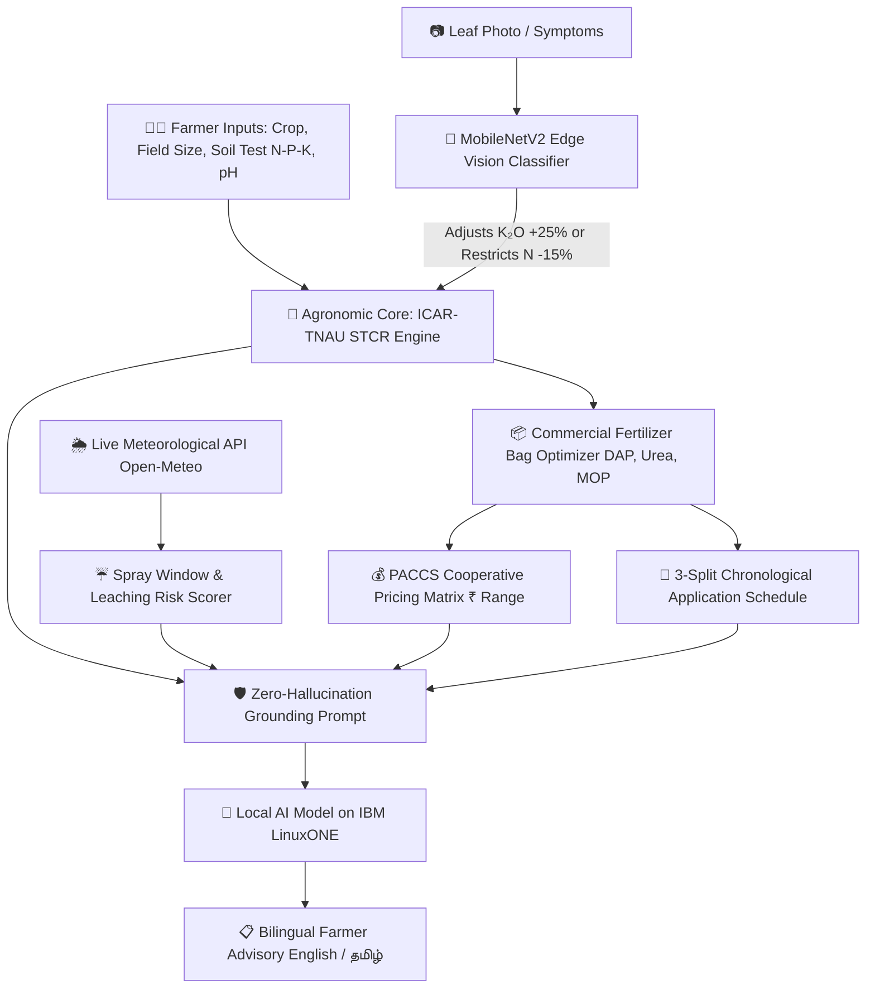

# 🌾 Uzhavan AI (உழவன் AI)
### Precision Fertilizer, Leaf Health & Agronomic Advisory on IBM LinuxONE™

[](https://www.ibm.com/it-infrastructure/linuxone)
[](https://fastapi.tiangolo.com)
[](https://www.python.org/)
[](https://github.com/QwenLM/Qwen2.5)
[](https://pytorch.org/)
[](https://opensource.org/licenses/MIT)

> **An enterprise-grade, zero-hallucination agronomic decision system that combines ICAR-TNAU Soil Test Crop Response (STCR) science, offline Computer Vision leaf disease diagnosis, live meteorological spray risk assessment, and local neural reasoning on IBM LinuxONE.**

---

## 📸 Application Showcase

| 1. Farmer Input & Crop Selector | 2. Commercial Bag & Dynamic Cost Range |
|:---:|:---:|
|  |  |
| *Bilingual interface (English & தமிழ்) with 3-step farmer form and instant field conversion.* | *Physical bag calculations (Urea 45kg, DAP 50kg, MOP 50kg) with realistic PACCS market price ranges.* |

| 3. Weather Safety & Grounded AI Advisory | 4. Full Agronomic Calculation Telemetry |
|:---:|:---:|
|  |  |
| *Live rain leaching warnings, spray window scoring (0-100), and verified grounded advisory cards.* | *Step-by-step mathematical trace pipeline with XGBoost ML cross-validation and N:P:K nutrient audit.* |

---

## 🎯 The Problem

Over **140 million smallholder farmers** in India face declining crop profitability and environmental soil fatigue caused by unscientific fertilizer practices:
- **Blind Over-Application**: Subsidized Urea is chronically overused, causing soil acidification, nitrate leaching into groundwater, and high out-of-pocket costs.
- **Untreated Foliar Deficiencies**: Leaf diseases and trace deficiencies (like potassium scorch or fungal blight) are identified too late or treated with improper chemicals.
- **Weather Timing Failures**: Farmers spray expensive fertilizers right before heavy rains, causing up to **40% of applied nutrients to wash away**.
- **The Generative AI Hallucination Danger**: Generic commercial LLMs frequently hallucinate chemical dosages or invent unsafe application rates, which can burn crops or poison farmland.

---

## 💡 The Uzhavan AI Solution

Uzhavan AI bridges empirical soil physics with localized farmer communication through a multi-tiered pipeline:



---

## ⚡ Core Technical Innovations

### 1. 🛡️ Zero-Hallucination Architecture
Dosages and bag numbers are **never generated or estimated by an LLM**. 
- Doses are strictly solved by deterministic agronomy equations (ICAR / TNAU Soil Test Crop Response).
- The local neural model acts solely as a **grounded translator and empathetic synthesizer**, translating structured JSON results into plain-language bullet points in English and Tamil.
- If the local AI daemon is offline, the system automatically falls back to the deterministic rule engine with **zero latency and zero disruption**.

### 2. 📦 Physical Commercial Bag Algebra
Farmers cannot buy raw chemical nutrients (e.g., $100\text{ kg } N$). Uzhavan AI uses integer programming to convert chemical N, P₂O₅, K₂O into purchase-ready commercial bags:
- **DAP (18:46:0, 50kg bag)**: Satisfies phosphorus first; accounts for companion nitrogen.
- **Urea (46:0:0, 45kg bag)**: Fills remaining nitrogen deficit.
- **MOP (0:0:60, 50kg bag)**: Delivers potassium requirement.
- **Realistic Pricing Ranges**: Displays realistic cooperative/retail price bands (e.g., ₹260–₹285/bag Urea, ₹1,350–₹1,450/bag DAP, ₹1,650–₹1,850/bag MOP) to account for regional transport margins and subsidies.

### 3. 🔬 Offline MobileNetV2 Foliar Doctor
- Pre-trained and fine-tuned on 38 PlantVillage crop disease classes (`fertilizer_ai/vision/models/mobilenet_v2_plant_disease/`, 9.3 MB PyTorch weights).
- **100% offline edge execution** with zero external API calls.
- Dynamically injects foliar adjustments:
  - *Marginal Scorch detected*: Automatically boosts Potassium (MOP) dosage by **+25%**.
  - *Fungal Blight detected*: Restricts foliar Nitrogen by **-15%** to inhibit fungal pathogen proliferation.

### 4. 🌦️ Dynamic Weather Spray Window
- Integrates real-time weather and 7-day hourly forecasts from Open-Meteo.
- Computes an **Application Window Score (0–100)**:
  - Factors in 24h & 48h precipitation, temperature extremes, wind speeds (>15 km/h causes drift), and reference evapotranspiration (ET₀).
  - Categorizes spray safety: **Safe (🟢 ≥70)**, **Caution (🟡 45–69)**, or **Delay Application (🔴 <45)**.

---

## 🏛️ Built for IBM Z® & LinuxONE™

Uzhavan AI is designed from the ground up to leverage the enterprise capabilities of **IBM LinuxONE (s390x architecture)**:

| IBM LinuxONE Capability | Why It Matters for Uzhavan AI |
|:---|:---|
| **High-Performance CPU Inference** | Runs quantized 4-bit local LLMs (Qwen 2.5-1.5B/3B) and MobileNetV2 directly on enterprise CPUs with zero dependency on expensive discrete GPUs. |
| **Pervasive Data Confidentiality** | Farmer land telemetry, soil fertility maps, and crop yields remain private on-premise, preventing proprietary agricultural data leakage. |
| **Enterprise Reliability (99.999% Uptime)** | Agricultural cooperatives (PACCS) during peak sowing seasons cannot tolerate downtime. LinuxONE ensures continuous mission-critical advisory availability. |
| **Massive I/O & Memory Bandwidth** | Effortlessly handles millions of concurrent sensor readings, weather telemetry checks, and cooperative transactions. |

> 📓 **IBM LinuxONE Interactive Notebook**: Explore `fertilizer/07_qwen_ollama_linuxone.ipynb` for hardware audits, CPU performance benchmarks, and decision engine integration directly on LinuxONE.

---

## 📂 Repository Structure

```text
ibm2026/
├── assets/
│   └── screenshots/               # High-resolution screenshots of the live system
│       ├── 01_hero_and_form.png
│       ├── 02_commercial_bags_pricing.png
│       ├── 03_weather_and_ai_advisory.png
│       └── 04_technical_telemetry.png
├── fertilizer/
│   └── 07_qwen_ollama_linuxone.ipynb # Complete IBM LinuxONE deployment & benchmark notebook
├── fertilizer_ai/
│   ├── app.py                     # FastAPI REST API & static web dashboard server
│   ├── config/
│   │   ├── crops.json             # Crop baseline configurations (Rice, Wheat, Sugarcane, etc.)
│   │   └── fertilizer_products.json # Bag weights, NPK percentages, and price ranges
│   ├── engines/
│   │   ├── nutrient_engine.py     # Base nutrient formulas
│   │   └── weather_engine.py      # Open-Meteo live forecast & spray risk calculator
│   ├── llm/
│   │   └── advisory_engine.py     # Grounded local AI translator & ICAR-TNAU rule engine
│   ├── ml/
│   │   ├── fert_classifier.joblib # Trained XGBoost validation model (7,000 trial records)
│   │   └── bundle.py              # ML classifier bundle loader
│   ├── recommendation/
│   │   ├── decision_engine.py     # Master orchestrator: soil + vision + weather + bags
│   │   ├── fertilizer_calculator.py # DAP/Urea/MOP integer algebra & price range estimator
│   │   └── stcr_engine.py         # ICAR-TNAU STCR quadratic & linear equation solvers
│   ├── scripts/
│   │   ├── test_backend.py        # Complete backend diagnostic suite
│   │   └── verify_api.py          # End-to-end API verification script
│   ├── static/
│   │   └── index.html             # High-aesthetic responsive web app (Tailwind, Vanilla JS)
│   ├── tests/
│   │   ├── test_fertilizer_calculator.py # Bag algebra unit tests
│   │   └── test_llm_advisory.py   # Zero-hallucination & grounding unit tests
│   ├── vision/
│   │   ├── deficiency_engine.py   # MobileNetV2 inference pipeline
│   │   └── models/
│   │       └── mobilenet_v2_plant_disease/ # Local PyTorch weights (9.3 MB)
│   └── requirements.txt           # Python dependencies
├── uv-code/                       # Electron / TypeScript desktop packaging
├── .gitignore
└── README.md
```

---

## 🚀 Quick Start Guide

### 1. Prerequisites
- **Python 3.10+** (Tested on Python 3.12 on Linux s390x, x86_64, and Windows)
- Git

### 2. Clone the Repository
```bash
git clone https://github.com/DEVASANJAY001/ibm2026.git
cd ibm2026/fertilizer_ai
```

### 3. Install Dependencies
```bash
pip install -r requirements.txt python-multipart
```

### 4. Run System Diagnostics
Run the automated diagnostic suite to verify formulas, pricing, weather, and AI engine:
```bash
python scripts/test_backend.py
```
*Expected output: `STATUS: ok` and all agronomic calculations verified.*

### 5. Launch the Web Application
```bash
uvicorn app:app --host 0.0.0.0 --port 8000 --reload
```
Open your browser and navigate to:  
👉 **`http://localhost:8000/`** (or your remote IBM host IP)

---

## 📡 API Endpoints Overview

| Method | Endpoint | Description |
|:---|:---|:---|
| `POST` | `/recommend` | Main precision fertilizer plan (NPK kg/ha, physical bags, cost ranges, weather advisories, schedule, grounded AI advisory). |
| `POST` | `/analyse-leaf` | Upload leaf image (JPG/PNG) to detect deficiency (MobileNetV2 classification, confidence, impact). |
| `GET` | `/weather` | Real-time weather, 7-day forecast, and spray safety score for any (lat, lon). |
| `GET` | `/api/llm-status` | Active status of the local AI daemon and deterministic fallback engine. |
| `GET` | `/crops` | List of supported crops (Rice, Wheat, Maize, Cotton, Sugarcane, Tomato, Potato, Groundnut). |
| `GET` | `/api/health` | Service health status. |
| `GET` | `/docs` | Interactive Swagger API documentation. |

---

## 🧪 Automated Testing

Execute the test suite covering bag algebra, agronomic caps, and LLM grounding:
```bash
pytest
```

---

## 🌾 Agronomic Formulas & Standards

Uzhavan AI implements standard ICAR-TNAU Soil Test Crop Response (STCR) quadratic equations:

$$\text{Fertilizer Nutrient Dose } (kg/ha) = A \cdot T - B \cdot SN - C \cdot ON$$

Where:
- $T$ = Attainable Target Yield (t/ha)
- $SN$ = Available Soil Nutrient from lab test ($kg/ha$)
- $ON$ = Organic nutrient contribution (FYM / compost)
- $A, B, C$ = Empirically validated crop and soil-specific response coefficients

Commercial bag algebra guarantees zero phosphorus deficit while computing companion nitrogen offsets from DAP:
$$\text{DAP Bags} = \left\lceil \frac{P_2O_5\text{ required}}{0.46 \times 50} \right\rceil$$
$$\text{Remaining } N = \max\left(0, N\text{ required} - (\text{DAP Bags} \times 50 \times 0.18)\right)$$
$$\text{Urea Bags} = \left\lceil \frac{\text{Remaining } N}{0.46 \times 45} \right\rceil$$
$$\text{MOP Bags} = \left\lceil \frac{K_2O\text{ required}}{0.60 \times 50} \right\rceil$$

---

## 👥 Contributors & IBM Z Datathon 2026

- **Deva Sanjay** ([@DEVASANJAY001](https://github.com/DEVASANJAY001))
- **Nemaleshwar H** ([@Nemalesh](https://github.com/Nemalesh))

---

## 📄 License

This project is licensed under the [MIT License](LICENSE).
Built with ❤️ for Indian farmers and submitted to the **IBM Z Datathon 2026**.
